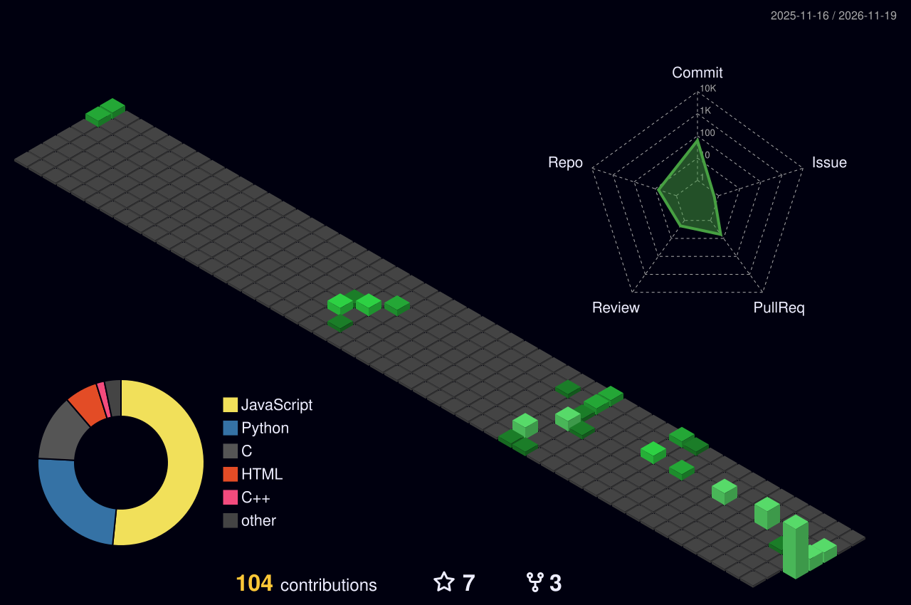

<div align="center">
  
</div>

<div align="center">
  <a href="https://github.com/TheNonConformist">
    
  </a>
</div>

<br />

### `❯ cat about.txt`

I build systems software and care about what happens below the abstraction.

Mostly **Rust** and **C**, with Python for the ML and glue layer. I like tight
binaries, explicit error handling, and benchmarks that don't lie.

```txt
▸ currently   digging through rust-lang/rust + rust-clippy internals
▸ interested  edge inference · runtimes · low-level networking
▸ daily driver Arch + Hyprland · Neovim · zsh
▸ open to     OSS collaboration and problems that bite back
```

<br />

### `❯ stack --list`

<div align="center">
  
</div>

<br />

### `❯ ls ~/work`

| project | what it is | stack |
| :--- | :--- | :--- |
| [Edge-Powered Sequential Anomaly Detection](https://github.com/TheNonConformist/Edge-Powered-Sequential-Anomaly-Detection-EP-SAD-) | on-device anomaly detection for streaming telemetry | `Python` |
| [Multi-Container Runtime](https://github.com/TheNonConformist/Multi-Container-Runtime) | a container runtime built from scratch in C | `C` |
| [Console-Based Social Network](https://github.com/TheNonConformist/Console-Based-SocialNetwork) | sockets, protocols and a social graph, all in the terminal | `C` |
| [Traffic Monitoring & Statistics Collector](https://github.com/TheNonConformist/Traffic-Monitoring-and-Statistics-Collector) | packet-level traffic analytics for the curious | `Python` |

<br />

### `❯ ./stats.sh`

<div align="center">
  
  
</div>

<div align="center">
  
</div>

<div align="center">
  
</div>

<div align="center">
  <a href="https://github.com/TheNonConformist?tab=achievements">
    
  </a>
</div>

<br />

### `❯ ./metrics --all`

<div align="center">
  
</div>

<br />

### `❯ tail -f activity.log`

<div align="center">
  
</div>

<div align="center">
  
</div>

<div align="center">

<!--RECENT_ACTIVITY:start-->
1. 👍 Approved [#28](https://github.com/ThouSyntaxTerror/SE_MiniProject_Railway_Reservation/pull/28#pullrequestreview-5971393967) in [ThouSyntaxTerror/SE_MiniProject_Railway_Reservation](https://github.com/ThouSyntaxTerror/SE_MiniProject_Railway_Reservation)<br>
2. 💪 Opened PR [#26](undefined) in [ThouSyntaxTerror/SE_MiniProject_Railway_Reservation](https://github.com/ThouSyntaxTerror/SE_MiniProject_Railway_Reservation)<br>
3. 💪 Opened PR [#25](undefined) in [ThouSyntaxTerror/SE_MiniProject_Railway_Reservation](https://github.com/ThouSyntaxTerror/SE_MiniProject_Railway_Reservation)<br>
4. 💪 Opened PR [#24](undefined) in [ThouSyntaxTerror/SE_MiniProject_Railway_Reservation](https://github.com/ThouSyntaxTerror/SE_MiniProject_Railway_Reservation)<br>
<!--RECENT_ACTIVITY:end-->

</div>

<br />

### `❯ ./snake.sh`

<div align="center">
  <picture>
    <source media="(prefers-color-scheme: dark)" srcset="https://raw.githubusercontent.com/TheNonConformist/TheNonConformist/output/github-snake-dark.svg" />
    <source media="(prefers-color-scheme: light)" srcset="https://raw.githubusercontent.com/TheNonConformist/TheNonConformist/output/github-snake.svg" />
    
  </picture>
</div>

<br />

### `❯ tail -f principles.log`

> Make it work. Make it right. Make it fast — in that order.
> If it needs a framework to print a line, it doesn't need to exist.
> Read the source. Then read it again.

<br />

<div align="center">
  <a href="mailto:nonconformistrizwan@gmail.com">
    
  </a>
  <a href="https://github.com/TheNonConformist">
    
  </a>
</div>

<br />

<div align="center">
  <sub><code>▍</code> built in the terminal, shipped without ceremony</sub>
</div>
